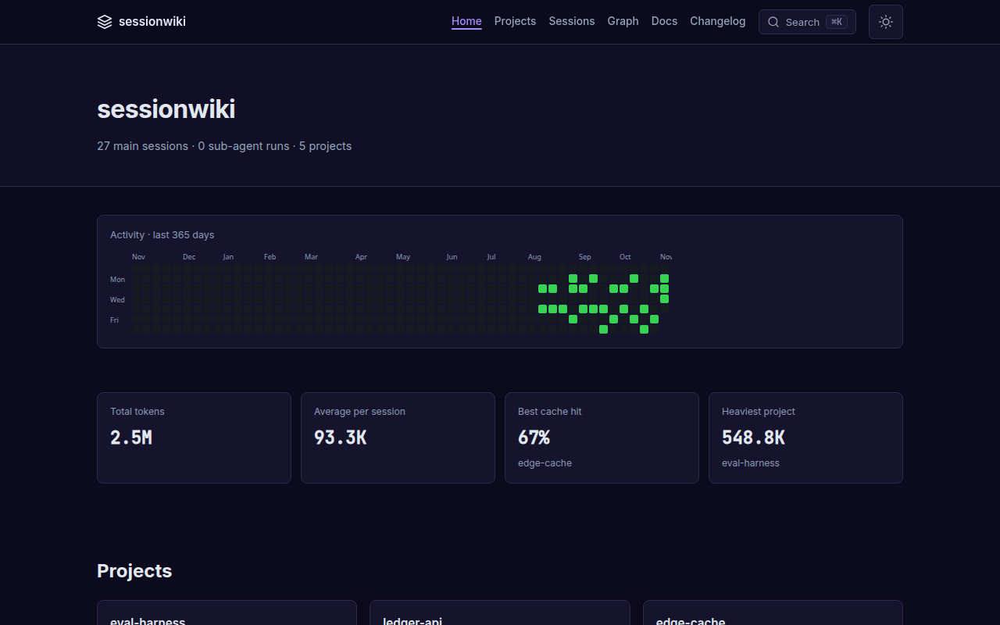
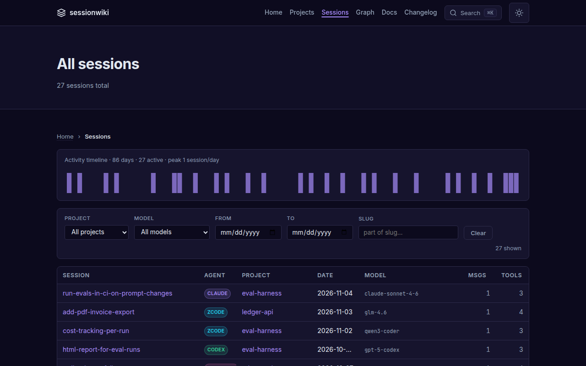
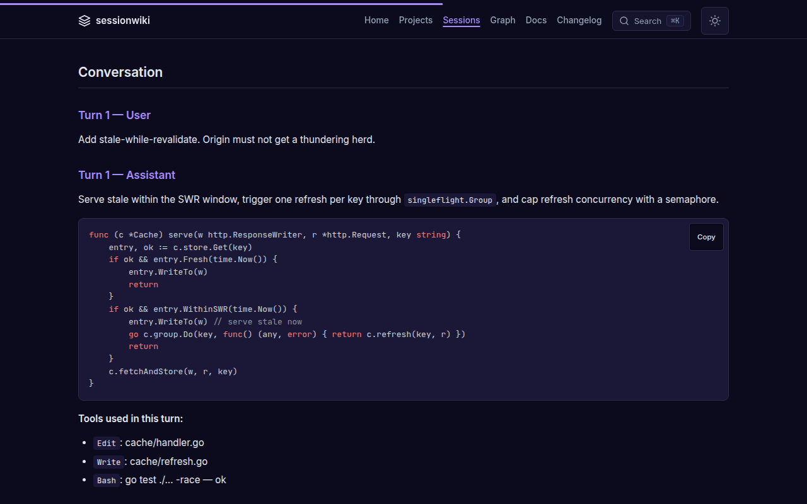
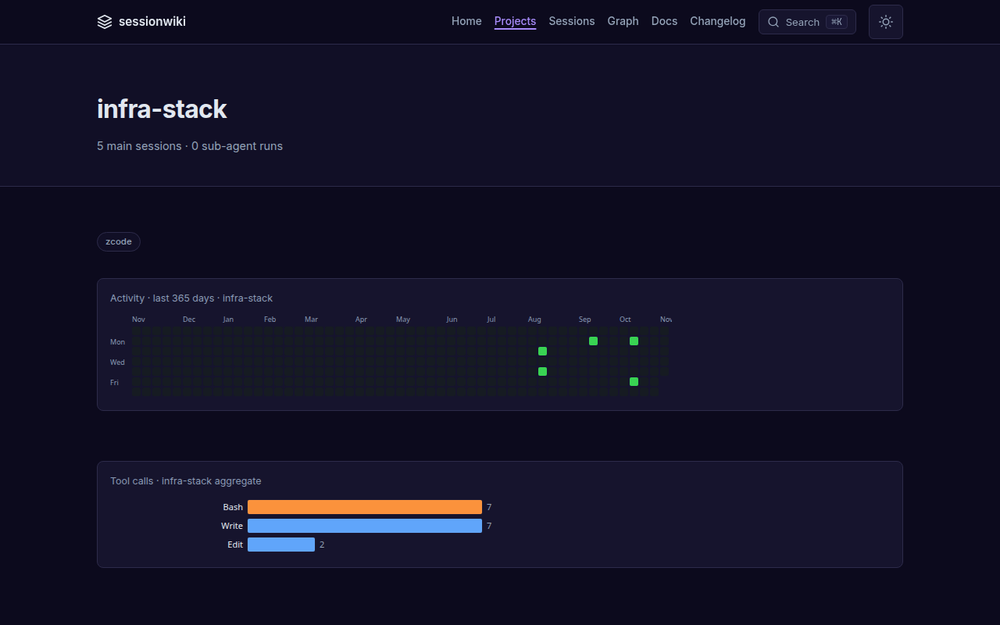
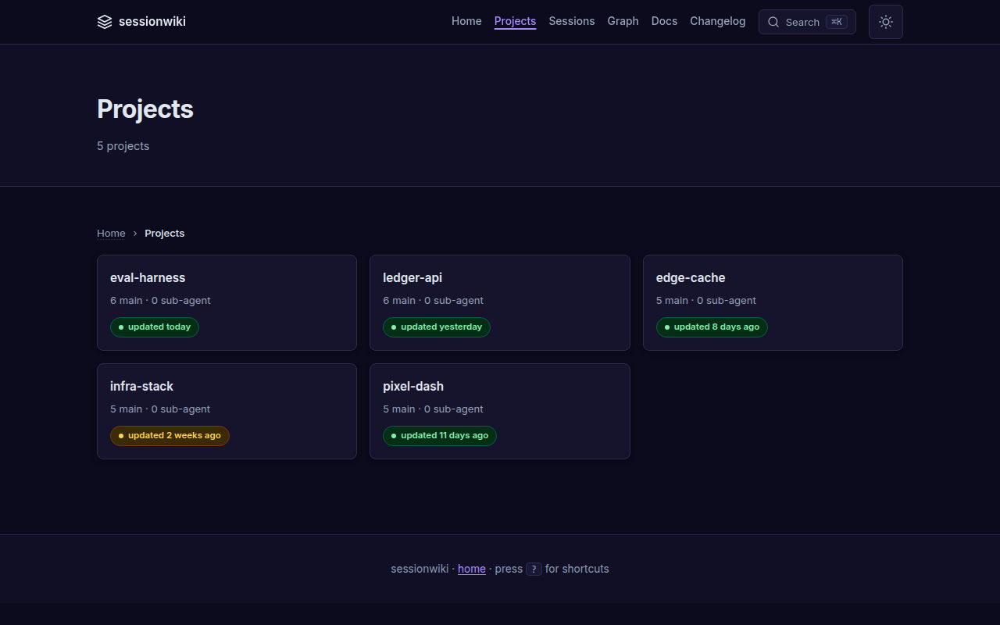
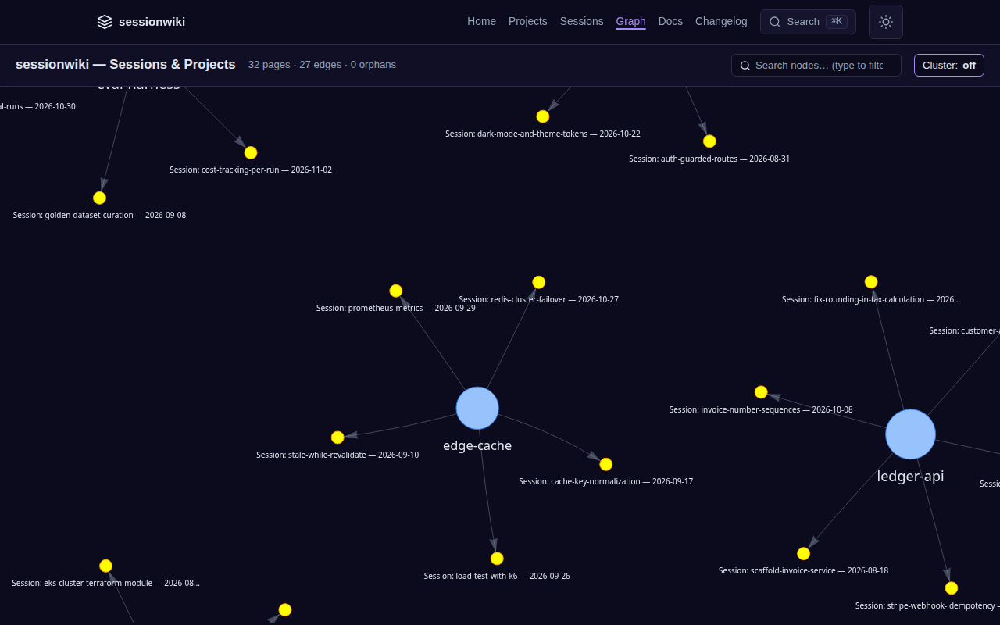
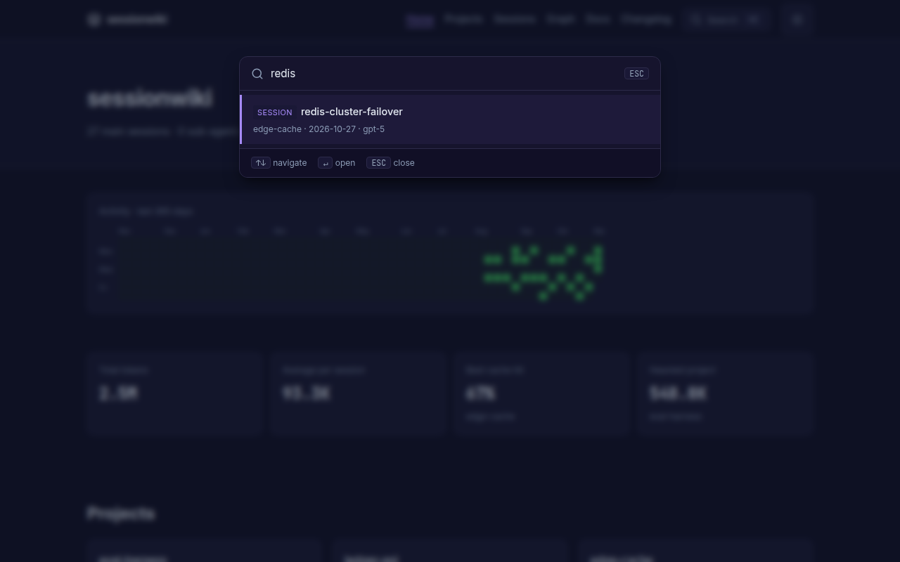

# sessionwiki

> **Your AI coding sessions, compiled into a searchable, interlinked wiki** — from Claude Code, Codex CLI, Cursor, Gemini CLI, Copilot, ZCode and OpenCode. Local-first, with LLM synthesis, a session graph, and an MCP server so your agents can look up what you already solved.

[](https://github.com/necroz/sessionwiki/blob/master/LICENSE)
[](https://www.python.org/)
[](https://github.com/necroz/sessionwiki/blob/master/CHANGELOG.md)
[](https://github.com/necroz/sessionwiki/tree/master/tests)
[](https://github.com/necroz/sessionwiki/actions/workflows/ci.yml)
[](https://github.com/necroz/sessionwiki/actions/workflows/link-check.yml)
[](https://github.com/necroz/sessionwiki/actions/workflows/wiki-checks.yml)
[](https://github.com/necroz/sessionwiki/pkgs/container/sessionwiki)

### 👉 [Live demo: necroz.github.io/sessionwiki](https://necroz.github.io/sessionwiki/)

27 synthetic sessions across five projects and seven agents (Aug–Nov 2026) — no personal data. Rebuilt from [`examples/demo-sessions/`](https://github.com/necroz/sessionwiki/tree/master/examples/demo-sessions) on every push to `master`.



---

## Why

Every agent you work with writes a full transcript to disk: the plan, the dead ends, the fix, the reasoning behind it. Hundreds of them, in five different formats, and you never look at them again.

sessionwiki turns that history into a knowledge base:

- **One place for every agent.** Claude Code, Codex CLI, Cursor, Gemini CLI, Copilot, ZCode and OpenCode sessions land in the same wiki, tagged by agent, project, model and date.
- **Always current.** Hooks, an OpenCode plugin and nightly timers keep it in sync without you running anything.
- **Readable.** LLM synthesis writes a summary page per session; low-signal sessions are folded into cluster pages instead of cluttering the wiki.
- **Usable by your agents.** A built-in MCP server lets Claude Code, ZCode or any MCP client search past decisions before redoing them.
- **Yours.** Everything runs locally; transcripts are redacted on the way in, and `sessionwiki audit` checks the output before you publish anything.

## Highlights

| | |
|---|---|
| **8 sources** | Claude Code, Codex CLI, Cursor, Gemini CLI, Copilot Chat / CLI, **ZCode**, **OpenCode**, Obsidian — each with its own agent badge |
| **Autosync** | Claude Code `Stop` hook, ZCode `Stop` hook + nightly systemd / launchd / Task Scheduler job, OpenCode `session.idle` plugin |
| **Synthesis backends** | Ollama, **any OpenAI-compatible server** (vLLM, SGLang, LM Studio, LiteLLM, hosted), agent-delegate, offline dummy |
| **Signal over noise** | Low-signal session coalescing, wikilink cleanup, concurrency control, cost `--estimate` |
| **Static site** | 365-day heatmap, token and cache stats, filterable sessions table, session pages with highlighted code, project pages with topics, session ↔ project graph, ⌘K search, dark mode |
| **MCP server** | 12 tools: query, search, read, list sources, lint, sync, exports, dashboard… |
| **AI exports** | `llms.txt`, `llms-full.txt`, JSON-LD graph, per-page `.txt` / `.json`, sitemap, RSS |
| **Safe by default** | Redaction of usernames and 17 secret patterns, read-only database exports, OS file locks and atomic state writes, `doctor` and `audit` |

## Screenshots

All screenshots come from the [live demo](https://necroz.github.io/sessionwiki/) and are regenerated with [`scripts/regen_docs_screenshots.py`](https://github.com/necroz/sessionwiki/blob/master/scripts/regen_docs_screenshots.py).

**Every session, every agent** — filter by project, model and date; each row carries its agent badge.



**Session pages** — the summary, the conversation, highlighted code and the tools that ran, plus token and cache usage.



**Projects** — topics, description, activity and tool usage per project, with freshness badges on the index.

|  |  |
|---|---|

**Graph and search** — sessions grouped around their projects; ⌘K searches every page instantly.

|  |  |
|---|---|

## Quick start

```bash
git clone https://github.com/necroz/sessionwiki.git
cd sessionwiki
./setup.sh                 # Windows: setup.bat — creates .venv, detects your agents
./sync.sh                  # convert new sessions into raw/
./build.sh && ./serve.sh   # build the site and open http://127.0.0.1:8765
```

`setup` creates a checkout-local `.venv`, installs the package, scaffolds `raw/`, `wiki/`, `site/`, enables the adapters for the agents it finds and runs `sessionwiki doctor`. The wrapper scripts use the venv automatically; for the CLI, activate it (`source .venv/bin/activate`) or call `.venv/bin/sessionwiki`.

Or install the published package — pick one:

```bash
uv tool install sessionwiki          # uv: CLI in its own isolated environment
uvx sessionwiki --help               # uv: run without installing
pip install sessionwiki              # pip, inside a virtualenv
pip install 'sessionwiki[graph]'     # + graphify graph engine (also works with uv tool install)
```

Docker — serve a site you have built (image `ghcr.io/necroz/sessionwiki`, see [Docker deployment](https://github.com/necroz/sessionwiki/blob/master/docs/deploy/docker.md) for `docker compose` and running CLI commands in the container):

```bash
docker run --rm -p 8765:8765 -v "$PWD/site:/wiki/site:ro" ghcr.io/necroz/sessionwiki
```

A step-by-step walkthrough with screenshots lives in the [setup guide](https://github.com/necroz/sessionwiki/blob/master/docs/tutorials/setup-guide.md).

## Connect your agents

**Claude Code, Codex CLI, Cursor, Gemini CLI, Copilot** — read straight from their session folders on `sessionwiki sync`. To sync after every Claude Code reply, add a `Stop` hook to `~/.claude/settings.json`:

```json
{
  "hooks": {
    "Stop": [{ "hooks": [{ "type": "command",
      "command": "cd /path/to/sessionwiki && .venv/bin/python -m sessionwiki sync --no-auto-build >/dev/null 2>&1 &" }] }]
  }
}
```

Parallel hook runs are safe: `sync` and `synthesize` take an OS file lock and write their state atomically.

**ZCode** keeps sessions in SQLite. sessionwiki exports them read-only and installs the hook and a nightly job for you:

```bash
sessionwiki zcode install --dry-run   # show what will be written
sessionwiki zcode install             # Stop hook + systemd / launchd / Task Scheduler
```

**OpenCode** (V2, `opencode.db`) gets a server plugin that runs autosync when a session goes idle:

```bash
sessionwiki opencode install --dry-run
sessionwiki opencode install          # honours $XDG_CONFIG_HOME
```

Hook-triggered runs skip instead of queueing when a cycle is already running; scheduled runs wait and catch up. Details: [ZCODE.md](https://github.com/necroz/sessionwiki/blob/master/ZCODE.md), [docs/adapters/opencode.md](https://github.com/necroz/sessionwiki/blob/master/docs/adapters/opencode.md), and `sessionwiki adapters` for the full list.

## LLM synthesis

`sync` fills `raw/` with redacted transcripts. `synthesize` turns them into wiki pages: a summary per session, project pages, cross-links. Point it at any backend in `config.local.json`:

```json
{
  "synthesis": {
    "backend": "openai",
    "base_url": "http://127.0.0.1:8000/v1",
    "model": "qwen3-coder",
    "max_concurrency": 8,
    "coalesce_low_signal": true
  }
}
```

```bash
sessionwiki synthesize --estimate     # what it will cost before you run it
sessionwiki synthesize                # new sessions only; idempotent
sessionwiki all --with-synth          # synthesize → build → graph → export → lint
```

Backends: `ollama` (local), `openai` (any OpenAI-compatible `/v1`: vLLM, SGLang, LM Studio, LiteLLM, hosted APIs), `agent-delegate` (let your coding agent write the pages), `dummy` (offline stubs). sessionwiki warns when a non-loopback `base_url` would send transcripts off your machine. See [docs/modes/api/](https://github.com/necroz/sessionwiki/tree/master/docs/modes/api).

## Ask your wiki from your agents (MCP)

```json
{
  "mcpServers": {
    "sessionwiki": {
      "command": "/path/to/sessionwiki/.venv/bin/python",
      "args": ["-m", "sessionwiki.mcp"],
      "cwd": "/path/to/sessionwiki"
    }
  }
}
```

Add it to Claude Code, Claude Desktop, ZCode or any MCP client. Tools include `wiki_query`, `wiki_search` (optionally over raw transcripts), `wiki_read_page`, `wiki_list_sources`, `wiki_lint`, `wiki_sync`, `wiki_export`, `wiki_dashboard` and more — 12 in total, stdio transport, no SDK dependency, path-traversal guarded.

## CLI reference

```bash
sessionwiki init                    # scaffold raw/ wiki/ site/
sessionwiki sync                    # export ZCode/OpenCode + convert transcripts to markdown
sessionwiki synthesize              # LLM summaries into wiki/ (--estimate, --coalesce-only, --force)
sessionwiki build                   # static site + AI exports
sessionwiki serve                   # local server on 127.0.0.1:8765
sessionwiki all                     # build → graph → export → lint (add --with-synth)
sessionwiki query "<question>"      # ask the wiki a question from the terminal
sessionwiki graph                   # session/project and wikilink graph
sessionwiki lint                    # wiki lint rules
sessionwiki export                  # llms.txt, JSON-LD, sitemap, RSS, …
sessionwiki candidates              # review candidate pages
sessionwiki adapters                # available adapters and their state
sessionwiki doctor                  # check Python, deps, config, agent paths
sessionwiki audit                   # scan raw/ wiki/ site/ for usernames and secrets
sessionwiki zcode                   # export · autosync · install
sessionwiki opencode                # export · autosync · install
sessionwiki version
```

Every subcommand has `--help`. Full reference: [docs/reference/cli.md](https://github.com/necroz/sessionwiki/blob/master/docs/reference/cli.md).

## Configuration

Settings are layered; later files win:

```
examples/sessions_config.json  →  config.json  →  config.local.json
   (shared defaults)              (gitignored)      (gitignored, machine-local)
```

Put machine-specific values — synthesis backend and keys, redaction patterns, project roots, adapter toggles — in `config.local.json`. Reference: [docs/configuration-reference.md](https://github.com/necroz/sessionwiki/blob/master/docs/configuration-reference.md). Use [`.llmwikiignore`](https://github.com/necroz/sessionwiki/blob/master/examples/.llmwikiignore) to exclude projects or sessions.

## How it works

```
 Claude Code · Codex · Cursor · Gemini · Copilot       ZCode · OpenCode (SQLite)
              │ JSONL                                          │ read-only export
              └──────────────────────┬─────────────────────────┘
                                     ▼
                       sync  →  raw/sessions/*.md          redacted, immutable
                                     │
                       synthesize    ▼
                                  wiki/                    sources · projects · entities · concepts
                                     │
                    ┌────────────────┼──────────────────┐
                    ▼                ▼                  ▼
                 build → site/   MCP server        exports (llms.txt, JSON-LD)
```

Three layers, following [Karpathy's LLM Wiki pattern](https://gist.github.com/karpathy/442a6bf555914893e9891c11519de94f): `raw/` is the immutable source of truth, `wiki/` is maintained by the LLM, `site/` is generated. Your `raw/` and `wiki/` are gitignored — your data never enters the repository.

## Privacy

- Transcripts are redacted on conversion: your username, home paths and 17 kinds of keys and tokens, plus your own patterns.
- ZCode and OpenCode databases are opened read-only.
- Nothing leaves your machine unless you configure a remote synthesis backend — and sessionwiki warns when you do.
- `sessionwiki audit` scans `raw/`, `wiki/` and `site/` before you publish a site.

See [docs/privacy.md](https://github.com/necroz/sessionwiki/blob/master/docs/privacy.md) and [SECURITY.md](https://github.com/necroz/sessionwiki/blob/master/SECURITY.md).

## Documentation

- **[Documentation hub](https://github.com/necroz/sessionwiki/blob/master/docs/index.md)** — start here
- [Setup guide](https://github.com/necroz/sessionwiki/blob/master/docs/tutorials/setup-guide.md) · [Installation](https://github.com/necroz/sessionwiki/blob/master/docs/tutorials/01-installation.md) · [Use with Claude Code](https://github.com/necroz/sessionwiki/blob/master/docs/tutorials/03-use-with-claude-code.md) · [Windows](https://github.com/necroz/sessionwiki/blob/master/docs/windows-setup.md)
- [CLI](https://github.com/necroz/sessionwiki/blob/master/docs/reference/cli.md) · [Configuration](https://github.com/necroz/sessionwiki/blob/master/docs/configuration-reference.md) · [Architecture](https://github.com/necroz/sessionwiki/blob/master/docs/architecture.md)
- [Deploy to GitHub Pages, Docker, Vercel/Netlify](https://github.com/necroz/sessionwiki/tree/master/docs/deploy)
- [What's different from llmwiki](https://github.com/necroz/sessionwiki/blob/master/docs/differences-from-llmwiki.md) · [Changelog](https://github.com/necroz/sessionwiki/blob/master/CHANGELOG.md)

## Based on llmwiki

sessionwiki started as a fork of **[llmwiki](https://github.com/Pratiyush/llm-wiki) by [Pratiyush](https://github.com/Pratiyush)** (MIT) at v1.3.82 and keeps its full history. Most of the converter, site, lint and MCP foundations are his work. sessionwiki adds the ZCode and OpenCode sources with autosync, the OpenAI-compatible synthesis backend, session coalescing, locking and atomic state, `doctor` and `audit`, the session graph, and a long list of fixes — see [what's different](https://github.com/necroz/sessionwiki/blob/master/docs/differences-from-llmwiki.md) and [how to migrate](https://github.com/necroz/sessionwiki/blob/master/docs/differences-from-llmwiki.md#migrating-from-llmwiki).

Thanks also to [Andrej Karpathy](https://gist.github.com/karpathy/442a6bf555914893e9891c11519de94f) for the LLM Wiki idea, [Python Markdown](https://python-markdown.github.io/), [highlight.js](https://highlightjs.org/) and [vis-network](https://visjs.github.io/vis-network/).

## Contributing

Read [CONTRIBUTING.md](https://github.com/necroz/sessionwiki/blob/master/CONTRIBUTING.md). Keep PRs to one concern, use `feat:` / `fix:` / `docs:` / `chore:` / `test:` titles, add a CHANGELOG entry for `feat` and `fix`, and never commit real session data. CI must be green.

## License

[MIT](https://github.com/necroz/sessionwiki/blob/master/LICENSE) © 2026 Igor Lashkevich (sessionwiki) · © 2026 Pratiyush (original llmwiki). See [NOTICE](https://github.com/necroz/sessionwiki/blob/master/NOTICE).
